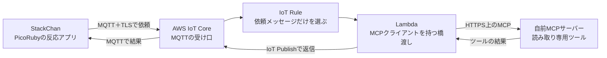

# StackChanカスタマイズ計画・初版

作成日：2026-10-31。方針更新：2026-11-07。状態：段階1の事前準備を開始。実機操作・書き込み・AWSへの変更は未実施。ビルド結果は[検証記録](../../verification/phase1.md)を参照。

> 実装担当エージェントへ：実行時は`executing-plans`を使い、各段階の完了条件を確かめて進める。この文書の作成は実装開始を意味しない。

**目的：** Arduino/C++で基本のカスタムを体験し、同じ動作をPicoRubyで実現した後、MQTT経由でAWS上の自前MCPサーバーを利用する。

**構成：** 本体の表示・タッチ・モーターを段階的に動かす。クラウド連携では、本体はMQTTを担当し、AWS側の橋渡し処理がMCPクライアントを担当する。

**使用技術：** Arduino IDE、C++、M5StackChan/M5Unified/M5GFX、PicoRuby/R2P2-ESP32、必要に応じたC拡張、AWS IoT Core、PythonのLambda、MCP SDK、AWS CDK。

## 1. 最初に押さえる全体像

おすすめの順番は次のとおり。

| 段階 | できるようにすること | 完成を目で確認する方法 |
| --- | --- | --- |
| 準備 | 機種を確認し、元に戻す準備をする | USBで認識でき、公式ファームウェアと復旧手順を確保できる |
| 1：Arduino/C++ | タッチをきっかけに表情・LED・首を変える | 自分で変えた表示や動きが本体に反映される |
| 2：PicoRuby | 段階1と同じ反応をRubyで作る | Rubyの変更で同じ動作が変わる |
| 3：MQTT＋AWS＋MCP | タッチで自前のMCPツールを呼ぶ | AWSから戻った結果に応じて表情・LEDが変わる |

最終デモは「頭をタッチ→待機中の顔→AWS上のMCPツールでデモ状態を取得→成功なら笑顔と緑LED、失敗なら困り顔と橙LED」とする。

最初のMCPツールは、固定のデモ情報を返す読み取り専用の`get_demo_status`とする。ファイル操作・メール送信・AWSリソース変更などの副作用を持たせない。LLMや音声認識は、この接続の実演には必要ない。

### 用語はこう捉える

| 用語 | このプロジェクトでの意味 |
| --- | --- |
| ファームウェア | StackChan本体に入れるプログラム。本体の起動や動作を決める |
| 書き込み／フラッシュ | USB経由で本体のプログラムを入れ替えること |
| Arduino | マイコン開発の環境・仕組み。今回のプログラムを書く言語はC++ |
| ライブラリー／ドライバー | 画面やモーターを扱うための部品。本体の細かな制御を任せる |
| サーボ | 指定した位置へ首を動かすモーター |
| PicoRuby | 小さな機器でRubyのプログラムを動かす仕組み。PCのRubyと使える機能が完全に同じではない |
| MQTT | 小さなメッセージを、名前付きの送受信先へ送る方式 |
| トピック | MQTTの送受信先の名前。例：`stackchan/demo-device/requests` |
| AWS IoT Core | 本体からのMQTT接続を受け持つAWSサービス |
| MCP | ツールの一覧取得や呼び出しのための共通プロトコル |
| 橋渡し処理 | MQTTの依頼をMCPの呼び出しに変換し、結果を返すプログラム |

## 2. 初版で置く仮定と、採用する方法

### 仮定

- 届いた本体はM5Stack製StackChan完成品、CoreS3系のESP32-S3を使った製品と仮定する。商品11129相当を候補とするが、実物は未確認。
- 作業用PCはmacOSとする。PicoRuby移植版の現行手順もmacOSを前提としている。
- 最初は完成品の内蔵部品だけを使う。分解・はんだ付け・追加センサー・配線変更は行わない。
- AWSは検証環境を使い、新規リソースの標準リージョン候補を東京`ap-northeast-1`とする。既存MCPの配置や利用サービスの提供状況に合わせて実装時に確定する。
- 自前MCPサーバーの有無、URL、通信方式、認証方法は未確認。既存があれば再利用し、なければ段階3で最小サーバーを用意する。
- 常時録音・撮影・音声会話・画像認識・自由な文章でのツール選択は、3段階の基本完成後の拡張候補とする。

機種が違った場合は、書き込み前に対応表を修正する。CoreS3単体や旧来の自作Stack-chan用のピン・サーボ設定を、完成品へそのまま適用しない。[製品資料](https://docs.m5stack.com/en/StackChan)

### 方法の比較

| 方法 | 向いている点 | 今回の扱い |
| --- | --- | --- |
| Arduino IDE＋C++ | 公式の機種別手順・サンプルを使って一つずつ確認できる | 段階1で採用 |
| PlatformIO＋C++／ESP-IDF直接 | 設定管理や低い層の調整がしやすいが、最初に覚えることが増える | C++の動作確認後に必要な部分だけ採用 |
| UiFlow2 | 画面で処理を組み立てやすい | 今回はC++からPicoRubyへの比較を優先する |

ArduinoとC++は二者択一ではない。Arduino IDEという開発ツールを使い、C++で書く組み合わせにする。[公式Arduino手順](https://docs.m5stack.com/en/arduino/stackchan/program)

PicoRuby段階では、[stackchan-picoruby](https://github.com/bash0C7/stackchan-picoruby)を土台にする。作者の対応機能・依存関係を再現し、まずはローカルな動作に絞る。Arduino版とPicoRuby版は、本体に交互に書き込む別のファームウェアとして扱う。

### 全段階で守る条件

1. 一度に一つの部品・機能を変え、動いた版を記録する。
2. 起動直後に首を大きく動かさない。動作の開始はタッチなど明示的な操作をきっかけにする。
3. マイクとカメラを使うコードは基本デモに含めない。
4. 認証情報は公開ソース・ログ・ファームウェアの配布物に含めない。
5. 書き込み成功、実機動作、AWS接続、MCPツール呼び出しは、それぞれ別の証拠として記録する。

### 2026-11-07に合意した開始方法

標準のAI会話・スマホ連携を引き継がず、画面とLEDだけの最小プログラムへ置き換える。フラッシュ全体を先に空にする操作は行わない。初期動作の確認、紐付け済みなら解除、復旧用ファームウェアの確保を済ませてから書き込む。

本体が手元にない間は、最小プログラム・開発環境・操作手順の準備を進める。型番や実機動作は未確認のまま扱い、実機確認を省略したことにはしない。

最初のプログラムは`firmware/arduino/minimal_offline/minimal_offline.ino`。公式BSPの一括初期化がサーボ電源も有効にするため、画面と台座I/O拡張を必要な範囲で初期化し、サーボ電源には無効化命令を送る。実際の動作は初回書き込み後に確認する。

自動でビルドを再現するためArduino CLIを使う。C++とM5Stackの公式ライブラリーを使う方針は同じで、Arduino IDEの導入は必須としない。

## 3. 準備：型番・初期状態・復旧を確認する

目安：2〜4時間。必要なものは本体、データ通信できるUSB-Cケーブル、Mac、動かせる机上のスペース。ネットワークは段階3で2.4GHz Wi-Fiを使う。

### 作業

- [ ] 箱と本体の製品名・型番・ハードウェア版を確認し、PicoRuby移植の対象と照合する。公開記録には個体のシリアル番号やQRコードを載せない。
- [ ] 電源・画面・タッチ・LED・首の初期状態を確認する。標準ファームウェアのクラウド機能は、送信先と送信内容を把握するまで有効化しない。オフラインで実施できない項目は「未確認」と残す。
- [ ] USBは原則として台座側を使い、抜き差し前後でMacのポート一覧を比較して対象を特定する。他のESP32機器は初回だけ外す。
- [ ] M5Burnerを公式の案内から用意し、StackChan用の「Only Official」に絞った復旧用ファームウェアをダウンロードする。選んだ名前と版を記録する。
- [ ] 起動しなくなった場合のダウンロードモードへの入り方を確認する。RSTを押し、緑のインジケーターで確認する。時間だけで判定しない。
- [ ] 原点・サーボ設定など、ユーザーが確認できる設定を手元に控える。必要なフラッシュ全体のバックアップは秘密情報扱いでローカルに保管する。
- [ ] 復元できる範囲を整理する。公式ファームウェアを書き戻せても、Wi-Fi設定・アプリの紐付け・会話履歴・校正値まで以前の状態に戻る保証はない。

復旧用の公式プログラムが手元にない、対象機種が一致しない、USB通信が不安定な状態ではカスタムを書き込まない。[公式の復旧案内](https://docs.m5stack.com/en/StackChan#restore-factory-firmware)

### 残すファイル

- `docs/device-baseline.md`：機種、ソフトウェア版、確認できた機能。固有IDは省く。
- `docs/recovery.md`：使った公式ファームウェア、ダウンロードモード、戻す操作、失われる可能性がある設定。
- `docs/toolchain.md`：Mac、IDE、ボード定義、ライブラリーの実際に使った版。

**準備の完了条件：** 対象機種・USB・復旧用ファームウェアが確認でき、元に戻す手順を説明できる。

## 4. 段階1：Arduino IDE＋C++で初めてのカスタム

目安：6〜10時間。ここではネットワークを使わず、本体だけで反応するプログラムを作る。

### 1-A：公式サンプルを動かす

- [x] 初回は[開発環境](../../toolchain.md)に沿ってArduino CLIで最小プログラムをビルドする。Arduino IDEは必要になったら追加する。
- [x] 公式のStackChan手順に沿ってボードを`M5CoreS3`にし、`M5StackChan`と使用する依存ライブラリーを入れる。実物の型番との照合は未完了。
- [x] 画面サンプルの公開要件であるM5Stackボード定義3.2.2以上、M5Unified 0.2.11以上、M5GFX 0.2.18以上を満たす互換な組み合わせを選ぶ。実際に通った版を固定し、途中で一斉更新しない。[画面サンプルの要件](https://docs.m5stack.com/en/arduino/stackchan/display)
- [x] 公式RGB LEDサンプルのAPIを参照し、サーボ電源を有効にする命令を送らない`minimal_offline`をコンパイルする。本体へはまだ書き込んでいない。
- [ ] 復旧準備を確認後、対象ポートへ最小プログラムを書き込む。LEDの色を一か所だけ変え、もう一度書き込んで変化を確かめる。
- [ ] 次に画面表示とタッチ入力を個別に確認する。これで「コード変更→コンパイル→USB書き込み→本体で確認」の流れを覚える。

**成果物：** `firmware/arduino/first_reaction/first_reaction.ino`、`docs/verification/phase1.md`。

### 1-B：同じデモの基本形を作る

- [ ] 起動時は待機顔と低輝度LEDを表示し、自動で首を振らない。
- [ ] 最初に画面のタッチで表情とLEDだけを変える。動いた後に、内蔵の頭のタッチへ入力を切り替える。
- [ ] 入力を押し続けても連続発火しないようにし、1回のタッチから1回の反応を作る。次の操作まで最低1秒空ける。
- [ ] モーターは公式の原点確認手順を参考に、位置の単位と中心を確認する。確認前に角度を推測して動かさない。
- [ ] 首の動きは一軸ずつ、確認済み中心から小さく動かす。上下は公式推奨5〜85度のさらに内側、初期目標として40〜50度に制限する。実機とAPIの座標が対応すると確認できた場合だけ使う。
- [ ] タッチ時の反応を「笑顔→緑LED→小さくうなずく→1秒後に待機」へまとめる。
- [ ] シリアルログは`boot`、`touch`、`reaction_done`程度に絞る。

サーボを手で無理に回さない。異音・引っ掛かり・異常な発熱が出たら動作を止め、必要なら電源を切る。USBを抜くだけでは内蔵電池で動き続ける可能性がある。[サーボの公式注意点](https://docs.m5stack.com/en/arduino/stackchan/servo)

### 検証と完了条件

- [ ] 電源を入れ直して3回とも待機表示で起動し、意図しない首の動きがない。
- [ ] タッチ10回に対し反応10回で、押し続けによる暴走がない。
- [ ] 10分間動かして再起動や異常な動作がない。
- [ ] 公式ファームウェアへ一度戻して基本動作を確認し、C++版も再び書き込める。
- [ ] ソースと使った版、操作、結果を記録し、実装時に`phase1-arduino-v1`として保存する。

**段階1の完了：** C++で自分の変更を反映でき、書き込みと復旧の両方を確認できた状態。

## 5. 段階2：同じ反応をPicoRubyで作る

目安：12〜24時間。C++版は残しておき、PicoRubyで何を変えたか比較できるようにする。

### 2-A：移植版を再現する

- [ ] 調査時の`stackchan-picoruby`のSHA`9fac4446ba73f46d09fbbf89e55ed22f11e323b3`を出発点に、最新との差分とライセンスを確認する。
- [ ] 参照ソースは`vendor/stackchan-picoruby/`へ取得する。上流へ直接変更を加えず、このプロジェクト用の変更は分けて残す。
- [ ] Ruby 4.0以上、Bundler、XcodeのSwift、ESP-IDF v5.4、QEMU関連依存を確認する。別プロジェクトのRubyやESP-IDFを上書きせず、この作業用の環境を分ける。
- [ ] `acceptance/lock.yml`のR2P2-ESP32・PicoRuby・ドライバーの組み合わせを確認する。upstreamのESP-IDF v5.5用手順を混ぜない。
- [ ] ビルドやセットアップ処理が何を実行・取得するか確認し、動く依存関係のSHAを`firmware/picoruby/upstream-lock.md`へ記録する。
- [ ] 上流へのビルド設定・スタックサイズ・通信追加の変更は、`firmware/picoruby/patches/`に差分として保存する。Git管理対象外の`vendor/`だけに変更を残さない。
- [ ] QEMUによる起動確認とホスト側の既存テストを実施し、失敗したまま実機への書き込みを進めない。
- [ ] 対象のUSB個体を選び、書き込み先を確認する。USBシリアル番号はローカル設定に保存し、公開しない。
- [ ] 最初はモーター自動動作・音声・外部通信を抑えた起動用アプリを用意し、移植版の書き込み手順で実機起動を確認する。

移植版は`r2p2:setup`、`r2p2:build_flash_appmrb`などのタスクを備えるが、書き込み処理にストレージの更新・消去を含む。実行前に固定SHAのタスクを確認する。設定や鍵を入れる前に、消える領域を把握する。[移植版のRakefile](https://github.com/bash0C7/stackchan-picoruby/blob/9fac4446ba73f46d09fbbf89e55ed22f11e323b3/Rakefile)

### 2-B：Rubyで段階1の反応を再現する

- [ ] `firmware/picoruby/apps/first_reaction.rb`を作り、「待機」「反応中」の状態をRubyで管理する。
- [ ] 表情を切り替える→LEDを変える→頭のタッチを読む→首を小さく動かす、の順で一つずつ追加する。
- [ ] C++版と同じタッチ間隔・動作範囲を使う。PicoRuby移植のサーボは正規化した座標を使うため、C++の角度をそのまま渡さず対応を確認する。
- [ ] 1秒後に待機へ戻る処理を作る。長い待機で入力処理を止めず、時刻を見て状態を切り替える。
- [ ] Rubyの一か所を変更し、LED色などが変わることを実機で確かめる。
- [ ] スタックの空きとメモリー使用を測る。例外処理で落ち得る既知の問題に対し、必要ならタスクスタックを増やして再ビルドする。通信追加前の最小空き量を記録する。
- [ ] スピーカーやMac側のAI連携は、この段階の必須にしない。通常動作で不要なBLEサービスは停止し、USBでの開発を基本にする。

PicoRubyでWi-Fi・MQTTが動かないことを、段階2の失敗とは扱わない。ここでの目的は、Rubyが本体の反応を制御すること。通信は段階3の別の検証対象になる。[移植版の対応表と既知の問題](https://github.com/bash0C7/stackchan-picoruby/blob/9fac4446ba73f46d09fbbf89e55ed22f11e323b3/README.md#capabilities)

### 検証と完了条件

- [ ] Mac側の制御アプリを止めた状態でも、頭のタッチから同じ反応を10回実行できる。
- [ ] 起動3回、連続動作30分で異常な再起動・動作がない。
- [ ] Rubyの変更が実機に反映される。画面が表示されただけでは完了にしない。
- [ ] Arduino版へ戻せる。PicoRuby版の再現手順・依存SHA・検証結果を残す。
- [ ] 実装時に`phase2-picoruby-v1`として保存する。

**段階2の完了：** Rubyがタッチ・表情・LED・安全な首の動きを制御できる状態。

## 6. 段階3：MQTTでAWS上の自前MCPサーバーにつなぐ

目安：24〜48時間。PicoRubyの通信部分に追加の移植作業が必要なら、さらに8〜24時間を見込む。

### 接続の形



MCPの標準通信方式はstdioとStreamable HTTP。MQTTとは別なので、LambdaにMCPクライアントを置く。MCPの認証トークンやAWS管理用のアクセスキーは本体に持たせない。[MCPの通信方式](https://modelcontextprotocol.io/specification/2026-07-28/basic/transports)

### 3-A：AWSのMQTT受け口と端末の登録を用意する

**作成対象：** `cloud/infra/`にPythonのAWS CDK、`docs/provisioning.md`に鍵を表示しない登録手順を置く。端末秘密鍵はIaCテンプレートやCloudFormation出力で生成・返却せず、端末別の登録工程で扱う。

- [ ] AWS SSOなどの一時認証で検証用アカウントへ接続する。既存環境と実行先を確認し、CDKの差分を確認する。
- [ ] IoT Thingを1台分作り、MQTTクライアントIDと対応させる。公開資料では`demo-device`という架空名を使う。
- [ ] 端末ごとのX.509証明書と秘密鍵を用意し、専用の最小権限IoTポリシーを付ける。
- [ ] 本体はMQTT 3.1.1、TLS、8883番を基本とする。SNIとサーバー証明書の検証を行う。ネットワークが8883番を使えない場合は、443番のALPN対応を別途検証する。[AWS IoTの接続方式](https://docs.aws.amazon.com/iot/latest/developerguide/protocols.html)
- [ ] Mac上のMQTTクライアントとAWS IoTのテストクライアントで、専用トピックの送受信を確認する。本体を使わずに、AWS側の登録・権限を切り分ける。
- [ ] Macで端末用クライアントIDを試した後は接続を終了する。本体と同じIDで同時接続しない。

| トピック | 本体の権限 | 用途 |
| --- | --- | --- |
| `stackchan/demo-device/requests` | Publish | MCPを利用したいという依頼 |
| `stackchan/demo-device/replies` | Subscribe＋Receive | 依頼に対する結果 |
| `stackchan/demo-device/status` | Publish | 起動、接続状態、最小限の稼働状態 |

実際のポリシーは対象端末・クライアントID・上のトピックに限定する。`iot:Connect`、`iot:Publish`、`iot:Subscribe`、`iot:Receive`を別々に設計し、`topic`と`topicfilter`のリソース指定を使い分ける。他の端末へのPublishやSubscribeが拒否される試験も行う。[AWS IoTポリシー例](https://docs.aws.amazon.com/iot/latest/developerguide/pub-sub-policy.html)

### 3-B：PicoRuby上の通信を確かめる

ここが最大の不確定要素。現行の移植版はWi-Fi・HTTP・MQTTの接続まで完成していないため、「gemを入れれば終わり」とは見積もらない。

- [ ] 動作済みのPicoRuby版から通信検証用の版を分ける。
- [ ] 使用中のforkとESP-IDFでWi-Fiを有効にし、2.4GHzの検証ネットワークへの接続を試す。既存のBLE設定との干渉も確認する。
- [ ] 時刻同期、DNS、TCP、TLSの順に確認する。時刻が不明な間はクラウドへの操作依頼を受け付けない。
- [ ] ルートCAとホスト名を検証するTLS通信を確認する。証明書検証を無効にして先へ進まない。
- [ ] 3-Aで登録した端末証明書と秘密鍵を本体へ登録し、相互TLS、MQTT接続、送信、購読を一つずつ試す。
- [ ] 無効なCA・別ホスト名・失効済み端末証明書で、接続や操作が拒否されることを確認する。
- [ ] Wi-Fiを一度切り、復帰後に自動再接続・再購読できることを確認する。

**採用の順序：** まず既存gemで必要な機能がそろうか確認する。不足する場合は、ESP-IDFのWi-Fi/TLSとESP-MQTTを使う小さなC拡張を作り、PicoRubyから呼ぶ。Rubyは「いつ何を送るか、結果でどう反応するか」を担当する。通信の低い層までRubyで書き直さない。[ESP-MQTTのAPI](https://docs.espressif.com/projects/esp-idf/en/v5.4/esp32/api-reference/protocols/mqtt.html)

追加するC拡張の境界は`connect`、`publish`、`subscribe`、`poll`、`disconnect`相当の操作に絞る。これはこのプロジェクトで設計するインターフェースであり、既存PicoRubyのAPI名を示したものではない。

- C側のネットワークコールバックからRuby VMを直接呼ばず、上限のあるキューに入れる。
- Ruby側が`poll`相当の操作で受け取り、画面・タッチ・サーボを処理する。
- 受信JSONは最大2KiB、受信キューは最大4件とし、超過時は破棄してエラー数だけ記録する。
- TLS接続中のメモリー最大使用量とタスクスタックを測り、表示・タッチと同時に動かして確認する。
- 普段使わないBLEは停止する。Wi-FiとBLEの同時動作は別の検証項目にする。

**見直し条件：** この通信検証に2作業日、約12〜16時間使っても、認証付きMQTT往復が成立しない場合は、詰まった層と残作業を記録して移植範囲を見積もり直す。安全性を下げて通過させない。

代替は「PicoRuby本体⇔USB／BLE⇔Macの中継アプリ⇔MQTT⇔AWS」。全体の連携を先に実演する用途には使える。ただしMacの常時起動が必要で、「本体単独でMQTT接続できた」という完了条件には含めない。BLEでは既存dRubyサービスを無条件に公開せず、近距離の第三者から操作されない対策も検証する。

### 3-C：自前MCPサーバーをAWSから呼べる状態にする

- [ ] 既存サーバーがある場合は、配置リージョン、URL、MCPの版、Streamable HTTP／旧SSE／stdio、認証方式、利用してよいツールを記録する。URLや認証情報の実値はローカル設定で管理する。
- [ ] 既存がstdioだけの場合は、そのままLambdaからHTTP接続できないため、同じコードをStreamable HTTPとしてAWSに配置する。旧SSEだけの場合もSDKの互換性を確認し、必要ならサーバー側を更新する。
- [ ] サーバーがない場合は、Pythonの公式MCP SDKで`get_demo_status`だけを公開する。返す値は`{"status":"ok","label":"demo"}`という固定データにする。
- [ ] 新規サーバーの標準配置先はAgentCore Runtimeとする。ARM64コンテナー、`0.0.0.0:8000/mcp`、基本はstatelessなStreamable HTTPを使う。新規構築は`cloud/mcp-demo/`に分ける。[AWSのMCP配置手順](https://docs.aws.amazon.com/bedrock-agentcore/latest/devguide/runtime-mcp.html)、[配置契約](https://docs.aws.amazon.com/bedrock-agentcore/latest/devguide/runtime-mcp-protocol-contract.html)
- [ ] 新規のAWS内通信はLambdaの実行ロールによるIAM/SigV4を標準とし、対象Runtimeへの呼び出しだけを許可する。MCPクライアントのHTTP送信に署名を組み込む。MCP SDKが自動的にAWS署名するとは仮定しない。[AgentCore認証の指針](https://docs.aws.amazon.com/bedrock-agentcore/latest/devguide/runtime-security-best-practices.html)
- [ ] 既存がOAuth等を使う場合はその方式に合わせ、機械間で認証を更新できることを確認する。必要な秘密値はSecrets Managerへ置き、ログへ出さない。
- [ ] PythonのMCPクライアントでツール一覧と`get_demo_status`の呼び出しを確認する。認証なし・権限なしの呼び出しは拒否されることを確認する。

MCP 2026-07-28以降と2025-11-25以前では、版の伝え方や初期化が違う。相手とSDKの対応を確認し、新しい版ではリクエストごとのメタデータ、以前の版では`initialize`などをSDKに任せる。セッションヘッダーがある構成では適切に引き継ぐ。[新しい版の仕様](https://modelcontextprotocol.io/specification/2026-07-28/basic/versioning)、[以前の版の仕様](https://modelcontextprotocol.io/specification/2025-11-25/basic/lifecycle)

既存サーバーの変更が必要な場合は検証用の版で試す。私用データや本番ツールを、この接続試験のデモデータに使わない。

### 3-D：MQTTとMCPの橋渡しを実装する

**ファイル：** `cloud/bridge/handler.py`、`cloud/bridge/mcp_client.py`、`cloud/bridge/request_store.py`、`cloud/bridge/tests/`。

- [ ] IoT Ruleは`requests`だけを対象にしてLambdaを起動する。`replies`や`status`で再起動し続けるループを作らない。
- [ ] Lambda呼び出し権限は、同じアカウントの対象IoT RuleのARNからだけに限定する。[IoTのLambdaアクション](https://docs.aws.amazon.com/iot/latest/developerguide/lambda-rule-action.html)
- [ ] LambdaでJSONの版・サイズ・依頼ID・期限・操作名を検証する。端末の識別はIoTポリシーとルールが渡すトピック情報に結び付け、本文の自己申告だけを信頼しない。
- [ ] 端末から受け取る操作は`get_demo_status`だけ許可する。任意のMCP URL、ツール名、シェルコマンドを本文から採用しない。
- [ ] DynamoDBに端末＋`request_id`を条件付きで記録し、重複や同時起動でMCPを何度も呼ばない。完了済みなら保存済みの短い結果を返し、処理中なら新たな実行を始めない。
- [ ] MCP結果の`status`だけを許可した値へ変換し、最大2KiB以内の返信にする。自由な文章をそのまま首の動作へ変換しない。
- [ ] LambdaからIoT Data PlaneのPublishで`replies`へ明示的に返す。Lambdaの戻り値だけでは端末に届かない。
- [ ] Lambdaの実行ロールは、対象MCPへの認証、返信トピックへのPublish、対象テーブル、必要な秘密値、ログに権限を絞る。
- [ ] IoT Ruleのエラー先とLambdaの非同期失敗先を用意する。SQS等には元の依頼も保存され得るため、依頼に秘密値や私用データを含めない。失敗先から自動で機器操作を再実行する仕組みにはしない。

MQTTのQoS 1は重複があり得る。IoTからのLambda呼び出しも非同期で重複し得るため、両方を考慮する。クラウドの処理完了とDB保存の間で落ちた場合の厳密な「必ず1回」は保証しない。初版は読み取り専用ツールとし、再送で副作用が増えない構成にする。[AWS IoT MQTT](https://docs.aws.amazon.com/iot/latest/developerguide/mqtt.html)、[Lambdaの再試行](https://docs.aws.amazon.com/lambda/latest/dg/invocation-async-error-handling.html)

### 3-E：本体とつなげて最終デモを完成させる

- [ ] 段階2のアプリに「接続待ち」「待機」「依頼中」「成功」「失敗」を追加する。
- [ ] 頭をタッチしたときだけ依頼を送る。同時に待つ依頼は1件、連続タッチは5秒間抑える。
- [ ] 成功時は笑顔と緑LED、失敗・タイムアウト時は困り顔と橙LEDにする。通信確認中は首を動かさず、安定後に段階2で検証済みの小さなうなずきを加える。
- [ ] 送信から20秒で待機を打ち切る。後から届いた期限切れの返信や、以前の起動時の返信では反応しない。
- [ ] Wi-Fi断中もローカルなタッチ表示は続ける。再接続後、古い依頼をまとめて送らず、新しいタッチを待つ。
- [ ] 証明書を一度失効させ、接続できなくなること、新しい証明書で復旧できることを確認する。
- [ ] Macの中継アプリを止めた状態で最終デモを行い、端末単独のMQTT往復を記録する。

## 7. メッセージと動作の約束

以下は架空の構造例。日時とIDは送信時に生成する。例の値をそのまま送信する手順ではない。

依頼：

```json
{
  "v": 1,
  "request_id": "demo-boot-001-1",
  "boot_id": "demo-boot-001",
  "action": "get_demo_status",
  "args": {},
  "sent_at": 1793421000,
  "expires_at": 1793421020
}
```

返信：

```json
{
  "v": 1,
  "request_id": "demo-boot-001-1",
  "boot_id": "demo-boot-001",
  "ok": true,
  "result": {"status": "ok", "label": "demo"},
  "expires_at": 1793421020
}
```

| 項目 | 初期設定と理由 |
| --- | --- |
| ID | `boot_id`は起動ごとの乱数、`request_id`は起動ID＋連番。再起動前の返信を除外する |
| 許可操作 | `get_demo_status`だけ。`args`は空オブジェクトだけ許可 |
| 時刻 | UTCのUnix秒。同期完了前はクラウド依頼を送らず、未来過ぎる依頼や期限切れを拒否 |
| サイズ | 依頼・返信ともUTF-8で最大2KiB。文字数ではなくバイト数で判定 |
| QoS | 依頼・返信は1。受信確認と、処理が完了したという返信は別に扱う |
| 保持 | 依頼・返信はretain=false。過去の命令を接続直後に実行しない |
| セッション | 初版はclean sessionを使い、再接続ごとに購読し直す。古い操作をためない |
| 再接続 | 1、2、4秒と待機を増やし、最大60秒。少し乱数を加え、再試行を集中させない |
| 待ち時間 | 本体20秒、Lambda15秒、MCP処理の目標上限10秒。待ち時間を超えた結果で動作しない |
| 重複 | AWSは端末＋IDをDynamoDBで管理。本体は処理済みIDを直近32件保持 |
| 記録の寿命 | 重複管理は24時間。DynamoDB TTLの削除時刻には依存せず、コードでも期限を検査 |
| 応答の扱い | 起動ID・依頼ID・期限が一致する返信だけ受け付け、受信1件から反応1回にする |

20秒は学習用デモの目標。クラウドの初回起動が遅ければ安全にタイムアウトする。実測後に待ち時間を見直し、期限切れチェックは保つ。

## 8. セキュリティ・プライバシー・停止方法

### 公開リポジトリに保存するものを限定する

- ソース、手順、架空の設定例、依存バージョン、匿名化した検証結果を保存する。
- Wi-Fi情報、端末秘密鍵・固有証明書、AWSの認証情報、MCPのトークンはローカルの非公開設定か秘密情報管理先に置く。
- 本体のQRコード・MACアドレス・USBシリアル番号・紐付け用コード・実際のMCP URLやアカウント識別情報は公開ログに載せない。
- 録音、写真、生ログ、フラッシュバックアップ、秘密値が入り得るビルド済みバイナリーは公開しない。
- `.gitignore`に加え、コミット前の差分と秘密情報検査を行う。誤公開した秘密値はファイル削除だけで済ませず、先に失効・交換する。
- 他者のコードを取り込む場合はライセンス表示を保つ。公開依存のセットアップを実行する前に処理と取得先を確認する。

### 本体とAWSの秘密情報を分ける

- 本体に入れるのは検証用Wi-Fi情報とその1台のIoT証明書・秘密鍵。AWSの管理者キーやMCPの資格情報は入れない。
- 鍵は公開ソースへ埋め込まず、USBを使うローカルな登録工程で保存する。まずは別のNVS領域等を候補に、ファームウェア更新が消去しないことを検証する。
- 更新で消える場合は、再登録する手順を明文化する。鍵をアプリの通常ストレージへ置いたまま消去タスクを実行しない。
- 開発初期のフラッシュ内の鍵は物理的に取り出せる可能性がある。検証専用の証明書を使い、持ち出し・常用前に暗号化保管や鍵保護を見直す。
- Secure Bootや暗号化設定でのeFuse書き込みなど、元に戻せない機器設定は初期手順に含めない。
- 本体から外部への接続だけを使い、家庭のルーターへポート開放しない。未使用のBLE・HTTPサーバーを常時公開しない。
- MCPの自由な戻り文やLLM出力から、任意ツール実行や無制限のモーター操作へつなげない。

### ログ、費用、停止

- 通常ログは版、匿名の依頼ID、成功／失敗の分類、処理時間だけにする。認証ヘッダー・JSON全文・音声・画像は記録しない。
- CloudWatch Logsはまず7日保存、検証用の失敗メッセージは1日を基準にする。共有時はさらに個体情報を取り除く。
- 小さな検証費用の目安として月額10米ドルのAWS Budget通知を設定する。これは見積額でも強制停止でもない。作成前にリージョン別の料金と、既存MCPを含む費用を確認する。
- 常時送信は最初は無効。必要になっても状態送信は5分に1回以下、接続イベントは発生時だけとする。
- 動作をすぐ止めるときは、本体のモーター動作を止めるか電源を切る。台座に電池があるためUSBだけに頼らない。
- クラウド操作を止めるときはIoT Ruleを無効化する。端末を切り離すときはIoT証明書を無効化して既存接続も切断する。
- 終了時は検証用リソース、証明書、残ったログ・失敗キューを確認し、不要分を削除する。既存MCPや他プロジェクトのリソースは削除対象に混ぜない。

## 9. 検証項目と、詰まったときの切り分け

| 試験 | 操作 | 合格条件 |
| --- | --- | --- |
| 通常往復 | 最終デモを10回実行 | タッチに対応した結果が10回戻り、1件から1回だけ反応する |
| 端末単独 | Macの中継を停止 | 本体だけでMQTT往復する。中継利用なら別の結果として記録 |
| 回線断 | Wi-Fiを30秒止めて戻す | ローカル表示が継続し、接続・購読が戻り、古い操作を実行しない |
| 重複 | 同じ依頼と返信を各3回流す | 同時実行を含めツール呼び出しを抑え、本体の反応は1回 |
| 再起動 | 返信待ち中に本体を再起動 | 以前の起動IDの返信を無視する |
| 期限切れ | 20秒より遅い返信を流す | タイムアウト表示になり、その後の返信で首が動かない |
| 認証失敗 | 無効なCA・失効証明書・MCP権限なしを使う | 接続または操作を拒否し、秘密値をログへ出さない |
| 他端末の操作 | 別端末のトピックへ送信・購読を試す | IoTポリシーで拒否される |
| 不正データ | 未知のaction、壊れたJSON、2KiB超のデータを送る | クラッシュせず拒否し、ツールとモーターを動かさない |
| サーバー障害 | MCPを停止／タイムアウトさせる | 制限時間で失敗表示となり、無限再試行しない |
| 連続運転 | 表示・タッチ・MQTTを30分以上動かす | 異常な再起動・スタック不足・継続的なメモリー減少がない |
| 更新と鍵 | アプリ更新後に再接続する | 鍵の保持、または手順どおりの再登録で復旧できる |
| 停止と復旧 | Rule無効化、接続切断、公式版への復旧を実施 | 操作停止と公式版の基本起動を確認できる |

クラウド部分の自動テストは、上の失敗を再現するものに絞る。`test_handler.py`で操作名・サイズ・期限の検証、`test_request_store.py`で同時取得と重複、`test_mcp_client.py`で正常・権限拒否・タイムアウトを検証する。実機のタッチやサーボは手動検証を残す。

詰まったら次の順で見る。複数の層を同時に直さない。

1. USB認識・電源・対象ボード。
2. 公式サンプルとC++版の基本動作。
3. PicoRubyの起動、入力、表示、スタック。
4. Wi-Fi、時刻、DNS、TLS、端末認証。
5. MQTTの送信・購読とIoTポリシー。
6. IoT Rule、Lambda起動、重複管理。
7. MCPの通信方式・版・認証・ツール実行。
8. MQTT返信と、本体でのID・期限・状態遷移。

**段階3の完了条件：** 上記の通常往復と主要な異常系が通り、PicoRubyが本体の反応を決め、AWS上の自前MCPツールを本体単独のMQTT経由で利用できる。中継版だけできた場合は、単独接続の未完了を明記する。

## 10. ファイル構成、作業順、見積もり

初版ではREADME、この計画、調査メモ、`.gitignore`を作成した。2026-11-07には、最小プログラムとビルド環境・確認手順も準備した。以下には準備済みのものと今後作るものを含む。実施状況は[検証記録](../../verification/phase1.md)に残す。

```text
README.md
.gitignore
config/                           ビルド設定と依存バージョン
scripts/                          セットアップとビルド
docs/
  research/2026-10-31-stackchan-feasibility.md
  superpowers/plans/2026-10-31-stackchan-customization.md
  device-baseline.md
  recovery.md
  toolchain.md
  provisioning.md
  first-flash.md
  verification/phase1.md
  verification/phase2.md
  verification/phase3.md
firmware/
  arduino/minimal_offline/minimal_offline.ino
  arduino/first_reaction/first_reaction.ino
  picoruby/apps/first_reaction.rb
  picoruby/apps/cloud_reaction.rb
  picoruby/upstream-lock.md
  picoruby/patches/                上流へ適用する変更を記録
  picoruby/native/network_bridge/  必要な場合だけ追加するC拡張
cloud/
  infra/                          AWS CDKと権限・ログ・通知の設定
  bridge/handler.py               入力検証、処理の振り分け、返信
  bridge/mcp_client.py            版と認証に合うMCP呼び出し
  bridge/request_store.py         DynamoDBによる依頼の管理
  bridge/tests/                   通信契約と異常系の自動テスト
  mcp-demo/                       新規MCPサーバーが必要な場合だけ作成
vendor/                           参照する上流。Git管理対象外
secrets/                          ローカル専用。Git管理対象外
```

| 順番 | 作業 | 目安 | 次へ進む条件 |
| --- | --- | --- | --- |
| 0 | 機種、USB、初期状態、復旧準備 | 2〜4時間 | 対象と復旧手順が確認できる |
| 1 | Arduinoサンプル→自分の反応→復旧実演 | 6〜10時間 | C++のカスタムと書き戻しができる |
| 2 | PicoRuby環境→同じ反応→単独動作 | 12〜24時間 | Rubyで本体の反応を制御できる |
| 3-A | AWS受け口と端末の登録 | 4〜6時間 | PCから専用トピックの送受信ができる |
| 3-B | Wi-Fi・TLS・MQTT通信の検証 | 8〜16時間 | 本体から証明書認証付きで往復できる |
| 3-C〜D | MCPと橋渡し | 8〜18時間 | 本体抜きでもAWS上で依頼と返信を追える |
| 3-E | 本体との統合、異常系、記録 | 4〜8時間 | 最終デモと停止・復旧を確認できる |

合計は44〜86時間を初期の作業量の目安とする。通信の追加移植が必要なら8〜24時間を追加し、52〜110時間程度へ広がり得る。実測に基づく納期の約束ではない。1回2時間なら基本部分で22〜43回程度になるため、まず段階1の完成を短期の到達点にする。

既存MCPがそのまま使えれば後半は短くなる。新規のMCP配置、認証方式の変更、対象機種の違いがあれば見積もりを更新する。

実装では、`phase1-arduino-v1`、`phase2-picoruby-v1`、`phase3-mqtt-mcp-v1`の順に動いた版を保存する。検証記録には「文書確認」「ビルドのみ」「実機確認」「AWS上の往復確認」を明記する。

最初の実作業は機種と復旧手順の確認。その次に公式RGB LEDサンプルを使い、「色を一つ変えて本体へ反映する」までを最小の一歩にする。
